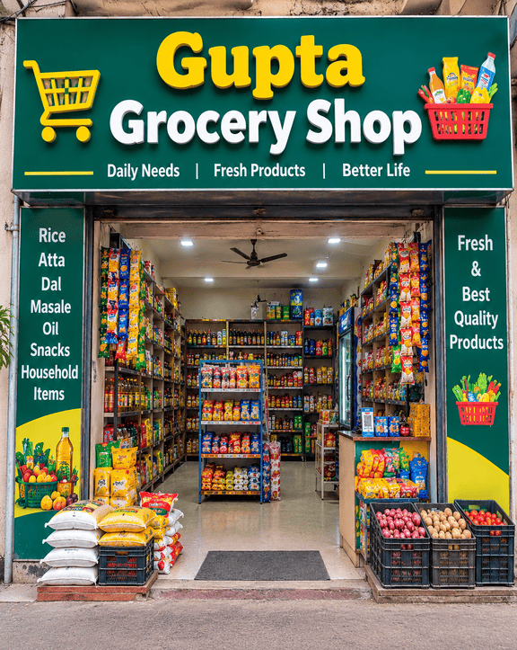

# Kanpur Wale Guptajee Grocery Store

A Windows desktop app for grocery inventory, billing, expiry monitoring, customer records, and sales analysis. Built with Python's `tkinter` and SQLite; store data remains on the local computer.

## Project preview

### Grocery store sign-in artwork



## Features

- Manage grocery stock by product, category, quantity, price, supplier, and expiry date.
- Search, add, edit, and remove inventory items.
- Create bills and update inventory in the same database transaction.
- Save customer name, address, and phone number; choose Cash, Credit card, Debit card, or UPI.
- Preview and print receipts with customer and payment details, bill number, item quantities and rates, total, and thank-you message. Customer phone numbers stay off printed receipts.
- Analyze sales for today, this week, this month, this year, or all time; search by customer, phone, or bill number.
- Export sales analysis to Excel with product totals and bill details side by side.
- Mark special dates and date ranges in the calendar and keep a five-item stock planning list.
- Monitor expired and soon-to-expire grocery stock.

## Requirements

- Python 3.10 or later with Tk/Tcl.
- No third-party Python packages are required.

Check your Python and Tk installation:

```sh
python --version
python -m tkinter
```

On Debian or Ubuntu, install Tk if needed with `sudo apt install python3-tk`.

## Run

From the project directory:

```sh
python login.py
```

Default demo login:

- Username: `sahilgupta4391`
- Password: `gaya@123`

The login screen displays these credentials beneath the sign-in button. To reset a forgotten login, change `DEFAULT_LOGIN_USERNAME` and `DEFAULT_LOGIN_PASSWORD` near the top of `database.py`, save the file, close the app, and run `python login.py` again. The configured values are synced to the existing local account once; passwords are stored in the database as salted hashes.

## Data and inventory

The app stores inventory, customers, calendar events, accounts, and bills in `data/grocery.sqlite`. Receipt text files are saved in `data/receipts/`. These local data files are excluded from Git by `.gitignore`.

A fresh database starts with 50 sample grocery products. The sample stock includes some already-expired products, some expiring soon, and longer-dated pantry and household goods so the expiry view has examples. Update the sample products in `GROCERY_SAMPLE_ITEMS` near the top of `database.py` to customize a new database. Existing inventory is not overwritten on app startup; the included project database has been populated with the 50-item grocery list while preserving saved bill history.

To use another database, set `GROCERY_DB_PATH` before launching:

```powershell
$env:GROCERY_DB_PATH = "$env:LOCALAPPDATA\SahilGroceryStore\grocery.sqlite"
python login.py
```

```sh
GROCERY_DB_PATH="$HOME/.local/share/sahil-grocery-store/grocery.sqlite" python login.py
```

## Project files

| File | Purpose |
| --- | --- |
| `login.py` | Sign-in, navigation, and overview dashboard |
| `database.py` | SQLite storage, login settings, inventory, bills, and sales rules |
| `stockdetails.py` | Grocery inventory screen |
| `billingdetails.py` | Billing and sales analysis |
| `calendarview.py` | Store calendar and stock planning notes |
| `excel_export.py` | Excel workbook export |
| `expirycheck.py` | Expiry monitoring screen |
| `ui.py` | Shared widgets and styling |

## License

MIT. See [LICENSE](LICENSE). Copyright (c) 2016–2017 Rohit Shankarrao Ukirde.
